# Authorization diagrams and code map

This is the visual companion to [`AUTHORIZATION.md`](./AUTHORIZATION.md). It is
written for someone new to NestJS: first the database, then how a request flows
through the API, then the main use cases.

> **How to view the diagrams:** GitHub renders Mermaid code blocks automatically.
> In VS Code/Zed, install a Mermaid preview extension, or paste individual blocks
> into <https://mermaid.live>. The six key diagrams are also checked in as PNGs
> under `docs/diagrams/`.

## At a glance (pre-rendered)

These PNGs are generated from the Mermaid blocks below. The Mermaid source is the
source of truth; regenerate the PNGs if the diagrams change.

### Database tables and relationships

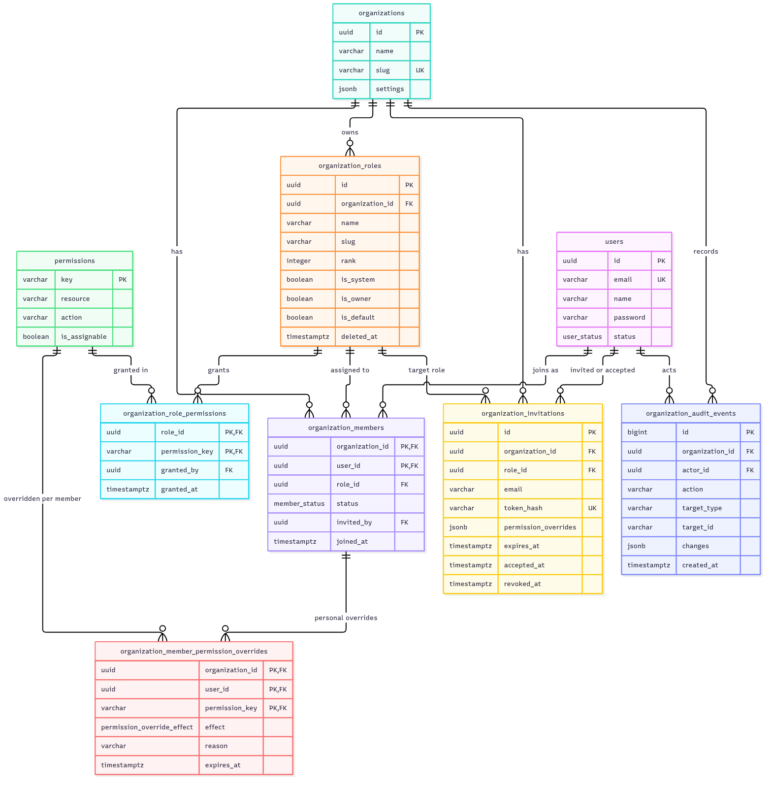

### Tenant-safe role keys

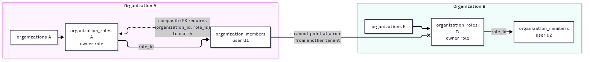

### How effective permissions are resolved

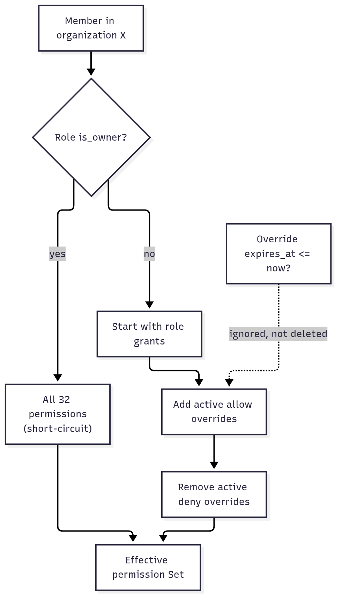

### API modules and their dependencies

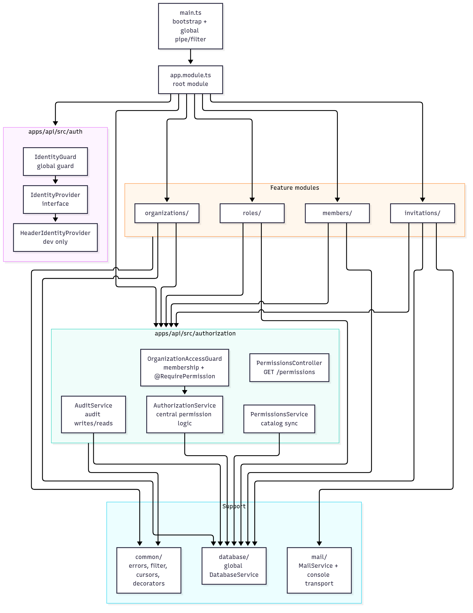

### One authenticated organization request

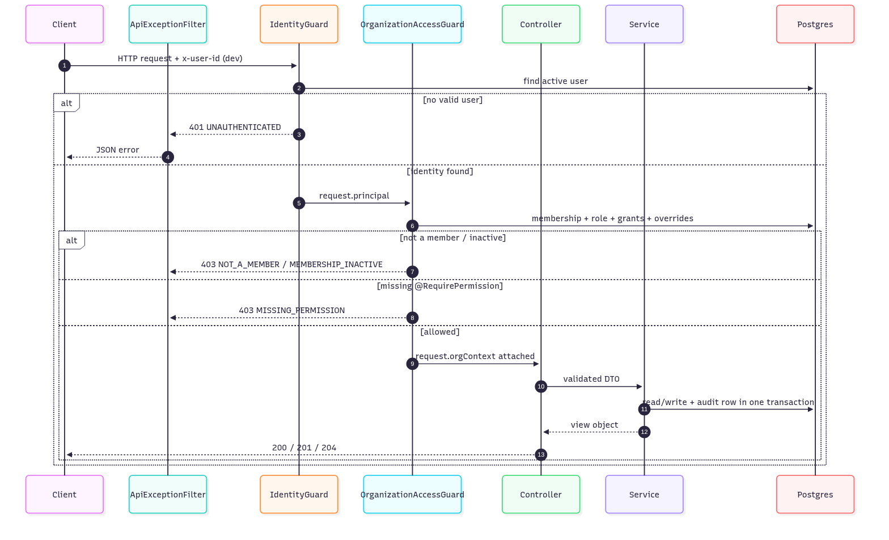

### Invitation lifecycle

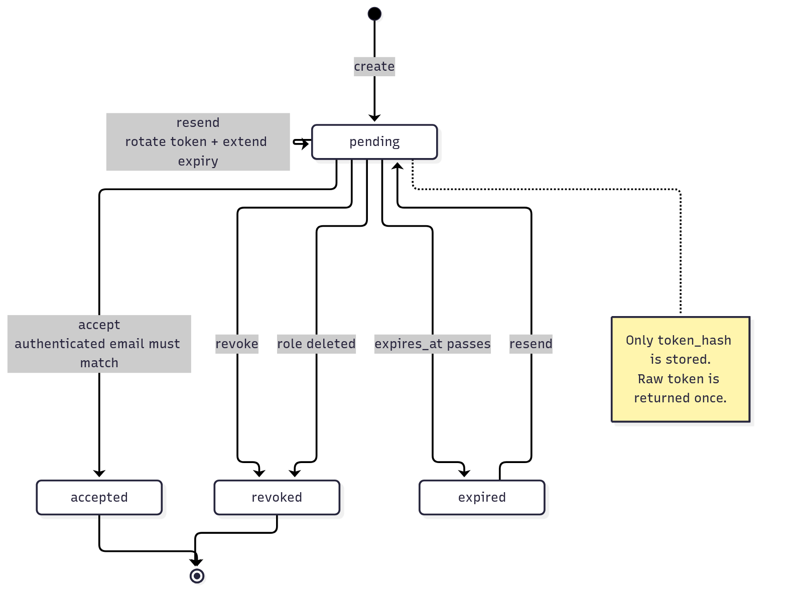

## Legend

| Shape / arrow | Meaning |
| --- | --- |
| Rectangle | A table, module, service or step |
| Diamond | A decision |
| `-->` | Normal flow |
| `-.->` | Dependency or "must match" relationship |
| `--x` | Blocked / not allowed |
| `||--o{` | One-to-many database relationship |

---

# Part 1 — Database diagram

## 1.1 Entity-relationship diagram

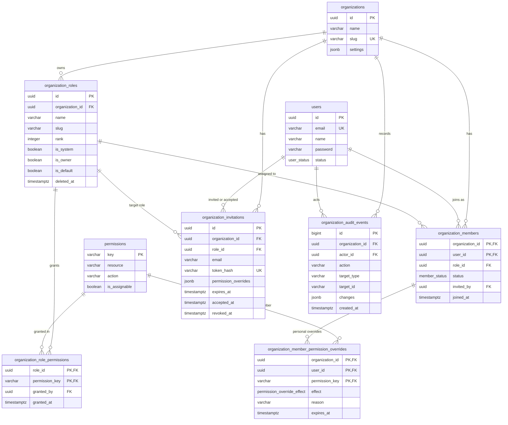

## 1.2 What each table is for

| Table | What it stores | Why it exists |
| --- | --- | --- |
| `users` | Global user accounts | A person can belong to many organizations |
| `organizations` | One workspace/tenant | The authorization boundary |
| `organization_roles` | Roles belonging to one organization | Roles are data, so each org can customize them |
| `permissions` | The global permission vocabulary | FK integrity and labels for the UI |
| `organization_role_permissions` | Which permissions a role grants | Many-to-many role ↔ permission |
| `organization_members` | One row per user per organization, with exactly one `role_id` | Membership + assigned role |
| `organization_member_permission_overrides` | Per-person allow/deny exceptions | Lets one member differ from their role |
| `organization_invitations` | Pending/accepted/revoked invites | Token-based invitation lifecycle |
| `organization_audit_events` | Security-sensitive changes | Who changed what, when |

## 1.3 The important key relationships

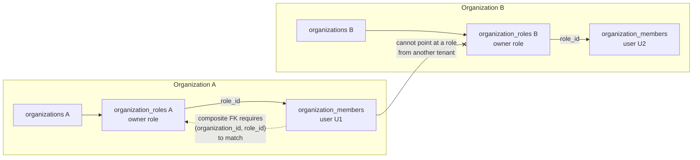

The composite foreign keys are the tenant-safety guarantee:

```text
organization_members(organization_id, role_id)
    -> organization_roles(organization_id, id)

organization_invitations(organization_id, role_id)
    -> organization_roles(organization_id, id)

organization_member_permission_overrides(organization_id, user_id)
    -> organization_members(organization_id, user_id)
```

## 1.4 Permission resolution (how the final permission set is built)

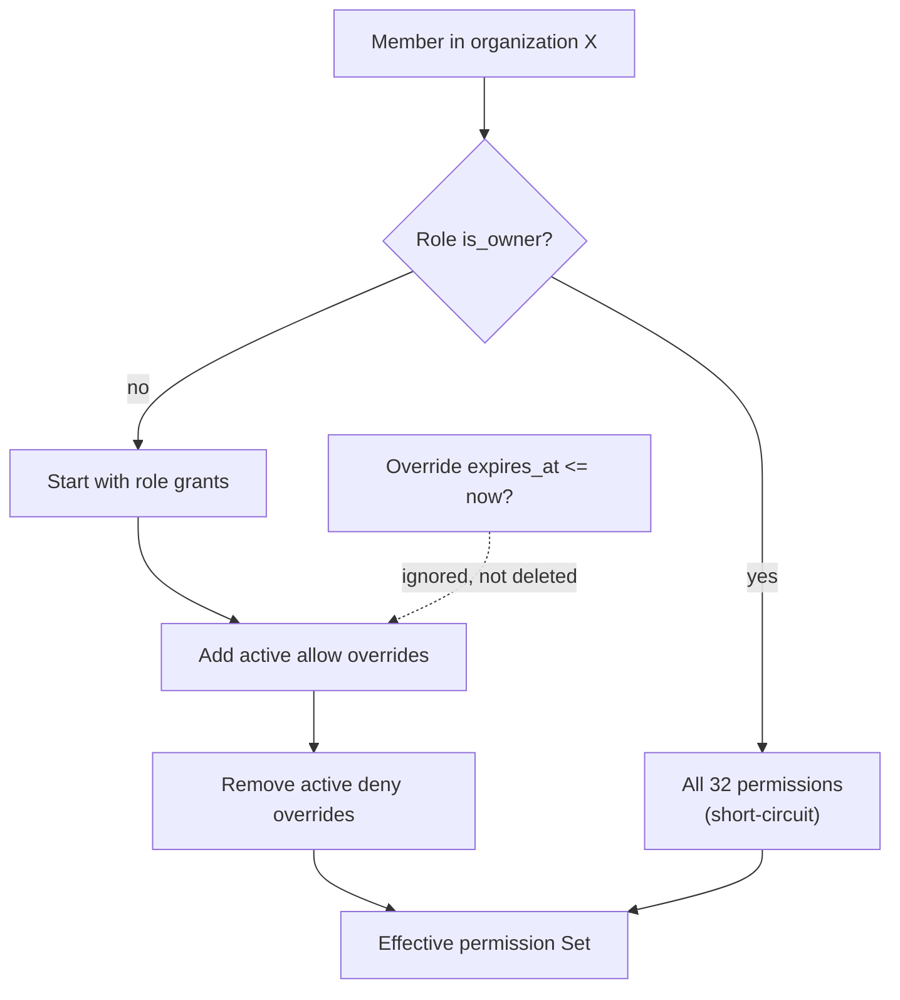

Example:

| Source | Permission | Result |
| --- | --- | --- |
| Role `member` grants | `issue.view` | allowed |
| Role `member` grants | `issue.create` | allowed |
| Override allow | `issue.delete` | added |
| Override deny | `issue.view` | removed |
| Expired allow | `org.update` | ignored |
| **Effective set** | | `issue.create`, `issue.delete`, plus the rest of the role grants |

## 1.5 Invitation state machine

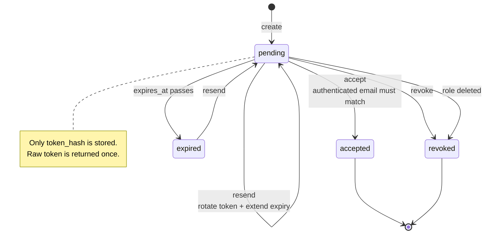

---

# Part 2 — NestJS mental model

If you are new to NestJS, these are the only concepts you need for this feature:

| Concept | Plain-English meaning | Example here |
| --- | --- | --- |
| **Module** | A folder that groups related code | `RolesModule`, `MembersModule` |
| **Controller** | Maps HTTP method + path to a function | `RolesController.create` |
| **Service** | Business logic and database work | `RolesService.create` |
| **Guard** | A bouncer that runs before the controller | `IdentityGuard`, `OrganizationAccessGuard` |
| **Decorator** | Metadata or parameter injection | `@RequirePermission(...)`, `@CurrentOrg()` |
| **DTO** | The shape of request input | Zod schemas in `*.dto.ts` |
| **Pipe** | Validates/transforms input before the controller | `StandardSchemaValidationPipe` |
| **Filter** | Converts exceptions into one JSON error shape | `ApiExceptionFilter` |
| **DI** | Nest creates class instances and passes dependencies through the constructor | `constructor(private readonly db: DatabaseService)` |

A request always moves in this order:

```text
HTTP request
  -> global IdentityGuard
  -> controller-level OrganizationAccessGuard
  -> pipe validates body/query/params
  -> controller method
  -> service method
  -> Postgres
  -> service returns a view object
  -> controller returns JSON
```

If anything throws, `ApiExceptionFilter` turns it into:

```json
{
  "statusCode": 403,
  "code": "MISSING_PERMISSION",
  "message": "You do not have the permission required for this action.",
  "details": { "missingPermissions": ["role.manage"] },
  "timestamp": "...",
  "path": "/organizations/.../roles"
}
```

---

# Part 3 — API module map

## 3.1 How the modules depend on each other

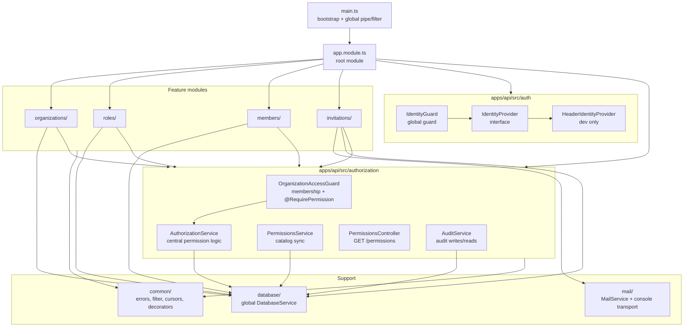

## 3.2 File-by-file map

| Folder / file | What it does | Read this when… |
| --- | --- | --- |
| `apps/api/src/main.ts` | Starts Nest, registers validation pipe, exception filter, shutdown hooks | You want to know global HTTP behaviour |
| `apps/api/src/app.module.ts` | Imports every feature module and config | You want the application wiring |
| `auth/auth.types.ts` | `Principal` = `userId`, `email`, `name` | You want to know what "logged in" means |
| `auth/identity-provider.ts` | Interface for authentication | You are adding Better Auth/OIDC |
| `auth/header-identity.provider.ts` | Dev-only `x-user-id` provider | You are testing locally |
| `auth/identity.guard.ts` | Global "who are you?" guard | You get a 401 |
| `auth/auth.module.ts` | Selects the provider; fails closed in production | You are wiring real auth |
| `authorization/organization-access.guard.ts` | Per-org "are you a member and do you have permission?" guard | You get a 403 |
| `authorization/authorization.service.ts` | Resolves membership/role/permissions and applies policy | You change an authorization rule |
| `authorization/permissions.service.ts` | Upserts the code catalog into Postgres | You add a permission |
| `authorization/permissions.controller.ts` | `GET /permissions` catalog endpoint | You build a role editor UI |
| `authorization/audit.service.ts` | Writes audit rows in the same transaction and lists them | You add an audited action |
| `authorization/authorization.types.ts` | `OrganizationContext`, `RoleSummary`, `MemberStatus` | You need the resolved request type |
| `organizations/organizations.controller.ts` | Org create/list/get/update/transfer/audit routes | You trace an org endpoint |
| `organizations/organizations.service.ts` | Org transactions, owner seeding, ownership transfer | You trace org business rules |
| `roles/roles.controller.ts` | Role CRUD and permission replacement routes | You trace a role endpoint |
| `roles/roles.service.ts` | Role CRUD, seeding, anti-escalation checks | You trace role rules |
| `members/members.controller.ts` | Member list/get/role/remove/overrides routes | You trace a member endpoint |
| `members/members.service.ts` | Member pagination, role changes, override replacement | You trace member rules |
| `invitations/invitations.controller.ts` | Admin invite list/create/resend/revoke routes | You trace invite admin actions |
| `invitations/public-invitations.controller.ts` | Public preview + authenticated accept | You trace the invitee flow |
| `invitations/invitations.service.ts` | Full invite lifecycle and acceptance transaction | You trace invite business rules |
| `mail/mail.service.ts` | Sends invite email; never breaks the DB transaction | You add a real email provider |
| `mail/console-mail.transport.ts` | Prints emails to the API log | You test locally |
| `common/api-exception.ts` | Typed `badRequest`/`forbidden`/`notFound`/`conflict` errors | You add an error code |
| `common/api-exception.filter.ts` | Converts every error to one JSON shape | You change error responses |
| `common/decorators/` | `@CurrentPrincipal`, `@CurrentOrg`, `@RequirePermission`, `@Public` | You add a route |
| `database/database.service.ts` | Postgres pool + Drizzle client | You need a DB query |
| `packages/auth/src/permissions.ts` | 32 permission keys + 6 role templates | You add/change a permission |
| `packages/auth/src/authorization.ts` | Pure policy functions | You change escalation rules |
| `packages/auth/src/invite-token.ts` | Token generation/hash/email normalization | You change invite security |
| `packages/db/src/schema/organization.schema.ts` | All org/role/member/invite/audit tables | You change the schema |

## 3.3 Literal folder tree

```text
apps/api/src/
├── main.ts                         # bootstrap: validation pipe + error filter
├── app.module.ts                   # imports every feature module
│
├── auth/                           # WHO is calling?
│   ├── auth.types.ts               #   Principal { userId, email, name }
│   ├── identity-provider.ts        #   interface to implement for real auth
│   ├── header-identity.provider.ts #   dev-only x-user-id provider
│   ├── identity.guard.ts           #   global guard, runs on every route
│   └── auth.module.ts              #   picks the provider, fails closed in prod
│
├── authorization/                  # WHAT are they allowed to do HERE?
│   ├── authorization.service.ts    #   membership + role + permissions + policy
│   ├── organization-access.guard.ts#   per-org guard + @RequirePermission
│   ├── authorization.types.ts      #   OrganizationContext, RoleSummary
│   ├── permissions.service.ts      #   syncs code catalog into Postgres
│   ├── permissions.controller.ts   #   GET /permissions
│   └── audit.service.ts            #   audit writes/reads
│
├── organizations/                  # feature: the workspace itself
│   ├── organizations.controller.ts #   HTTP routes
│   ├── organizations.dto.ts        #   Zod request schemas
│   ├── organizations.service.ts    #   transactions: create, update, transfer
│   └── organizations.module.ts     #   Nest wiring
│
├── roles/                          # feature: role catalog
│   ├── roles.controller.ts
│   ├── roles.dto.ts
│   ├── roles.service.ts            #   CRUD + seeding + anti-escalation
│   └── roles.module.ts
│
├── members/                        # feature: people in an org
│   ├── members.controller.ts
│   ├── members.dto.ts
│   ├── members.service.ts          #   list, role change, remove, overrides
│   └── members.module.ts
│
├── invitations/                    # feature: invite lifecycle
│   ├── invitations.controller.ts   #   admin list/create/resend/revoke
│   ├── public-invitations.controller.ts # public preview + accept
│   ├── invitations.dto.ts
│   ├── invitations.service.ts      #   token, expiry, acceptance transaction
│   └── invitations.module.ts
│
├── mail/                           # email boundary
│   ├── mail.service.ts             #   never throws into the DB transaction
│   ├── console-mail.transport.ts   #   prints email to the log (dev)
│   ├── mail.types.ts
│   └── mail.module.ts
│
├── common/                         # shared helpers
│   ├── api-exception.ts            #   typed HTTP errors with stable codes
│   ├── api-exception.filter.ts     #   one JSON error shape
│   ├── cursor.ts                   #   opaque keyset pagination
│   ├── pg-error.ts                 #   unique-violation detection
│   ├── slug.ts                     #   URL-safe slugs
│   └── decorators/
│       ├── current-principal.decorator.ts
│       ├── current-org.decorator.ts
│       ├── require-permission.decorator.ts
│       └── public.decorator.ts
│
└── database/                       # global Postgres access
    ├── database.service.ts         #   pg Pool + Drizzle client
    └── database.module.ts          #   @Global, so every module can inject it
```

## 3.4 "Which file do I edit?" quick lookup

| Task | File(s) |
| --- | --- |
| Add a new permission key | `packages/auth/src/permissions.ts`, then use `@RequirePermission(...)` in a controller |
| Change who gets a permission by default | `packages/auth/src/permissions.ts` role templates + a data migration for existing orgs |
| Change an escalation/rank rule | `packages/auth/src/authorization.ts` |
| Add a new HTTP endpoint | new method in a feature `*.controller.ts`, logic in `*.service.ts`, input schema in `*.dto.ts` |
| Protect an endpoint | `@UseGuards(OrganizationAccessGuard)` + `@RequirePermission("...")` |
| Let a route skip login | `@Public()` (use sparingly; only invite preview does) |
| Change the error JSON shape | `common/api-exception.filter.ts` |
| Add a new error code | `common/api-exception.ts` or throw `forbidden("CODE", "...")` |
| Change invite email content | `mail/mail.service.ts` |
| Add a real email provider | implement `MailTransport` + register in `mail/mail.module.ts` |
| Add real authentication | implement `IdentityProvider` + register in `auth/auth.module.ts` |
| Change a table/column/index | `packages/db/src/schema/*.schema.ts` + generate a migration |
| Change the effective-permission algorithm | `packages/auth/src/authorization.ts` (`resolveEffectivePermissions`) |
| Add an audit event | call `AuditService.record(tx, ...)` inside the existing transaction |
| Change the seeded roles | `packages/auth/src/permissions.ts` (`SYSTEM_ROLE_TEMPLATES`) + a backfill migration |

---

# Part 4 — Request lifecycle

## 4.1 Every authenticated organization request

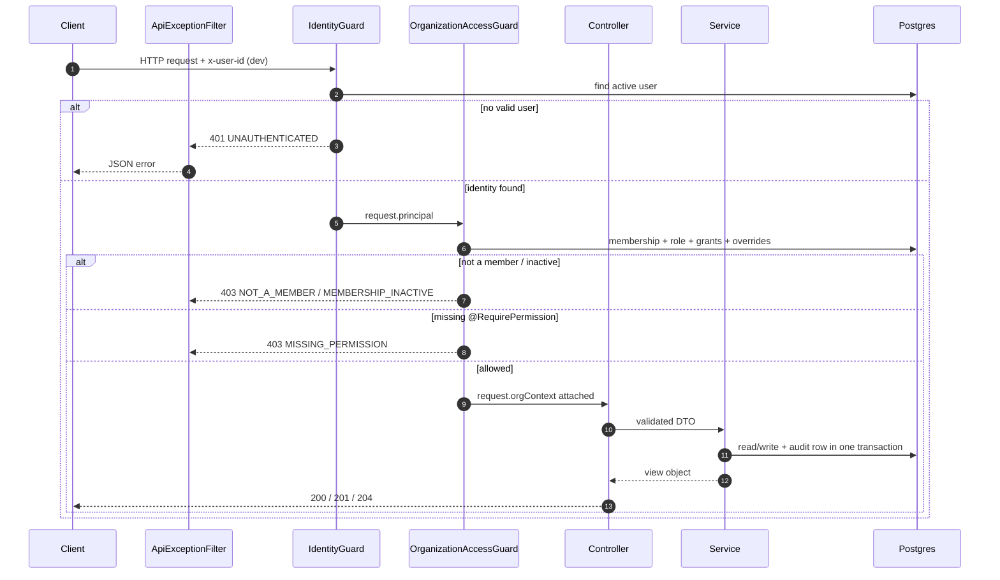

### Why there are two guards

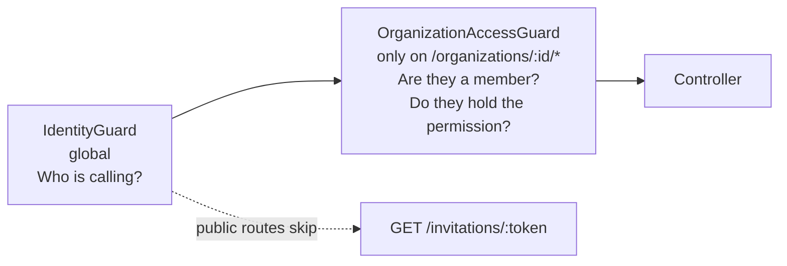

- `IdentityGuard` is registered once in `AuthModule` as `APP_GUARD`.
- `OrganizationAccessGuard` is applied with `@UseGuards(...)` on org-scoped
  controllers. It needs `:organizationId` from the route, so it cannot be global.

## 4.2 Permission check inside the guard

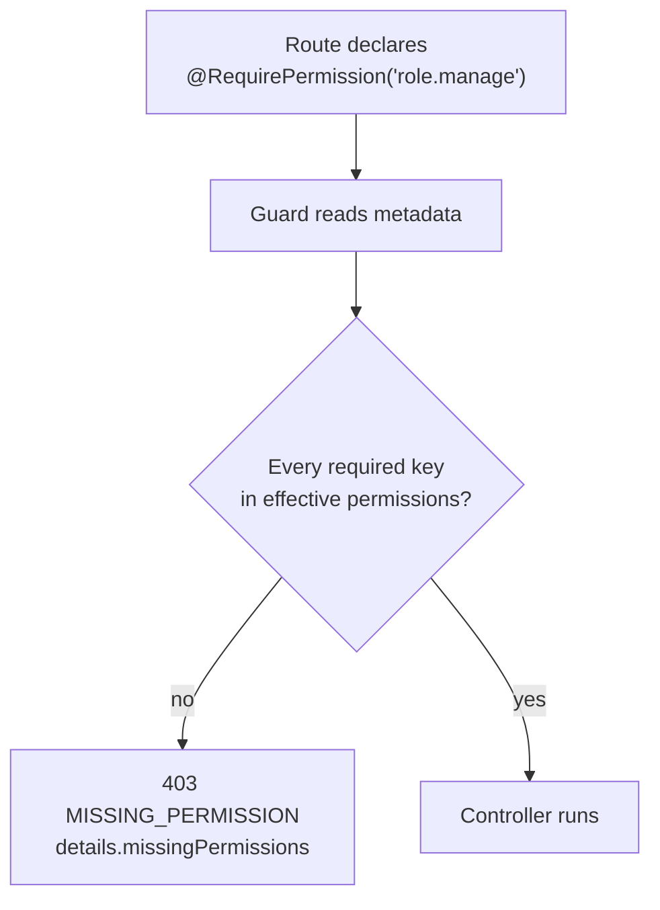

---

# Part 5 — Authorization decisions

## 5.1 The rank ladder

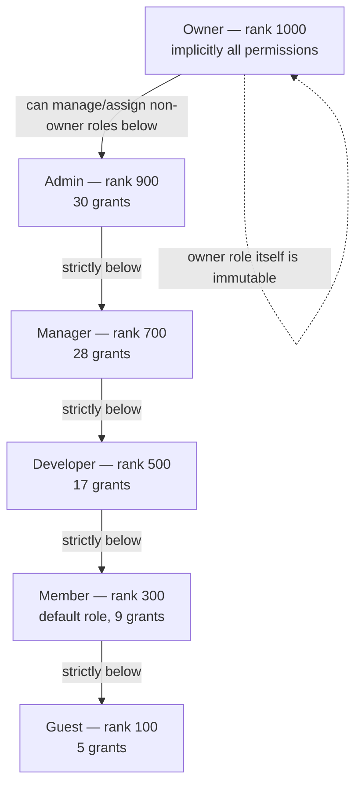

Rules:

- Higher rank = more authority.
- You can only manage or assign a role/member with a **strictly lower** rank.
- The owner bypasses rank comparisons, but still:
  - cannot edit/delete the owner role,
  - cannot assign the owner role,
  - cannot modify themselves,
  - cannot remove the last owner.
- Rank is only the first gate. The permission-subset and assignment rules still
  apply.

## 5.2 Can I manage or edit a role?

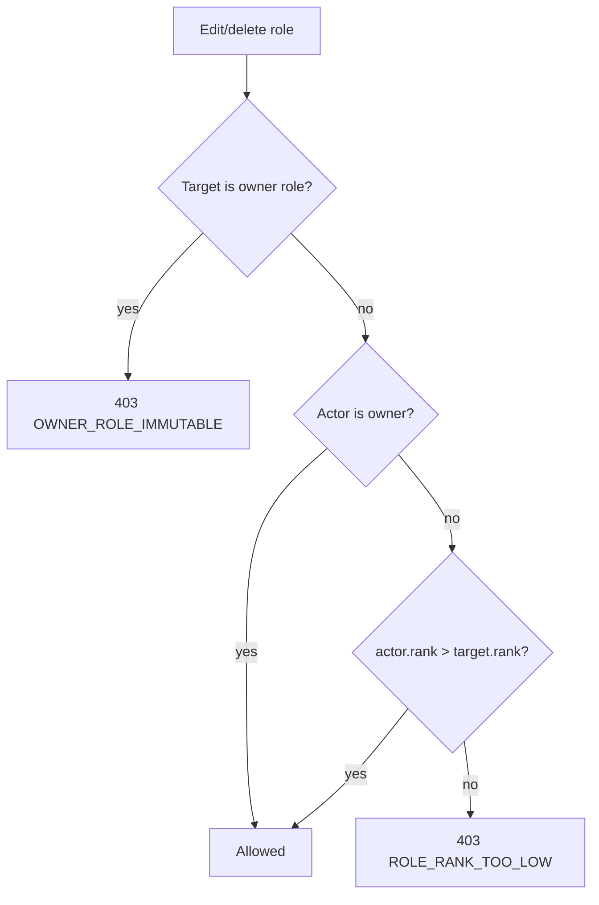

## 5.3 Can I grant a permission?

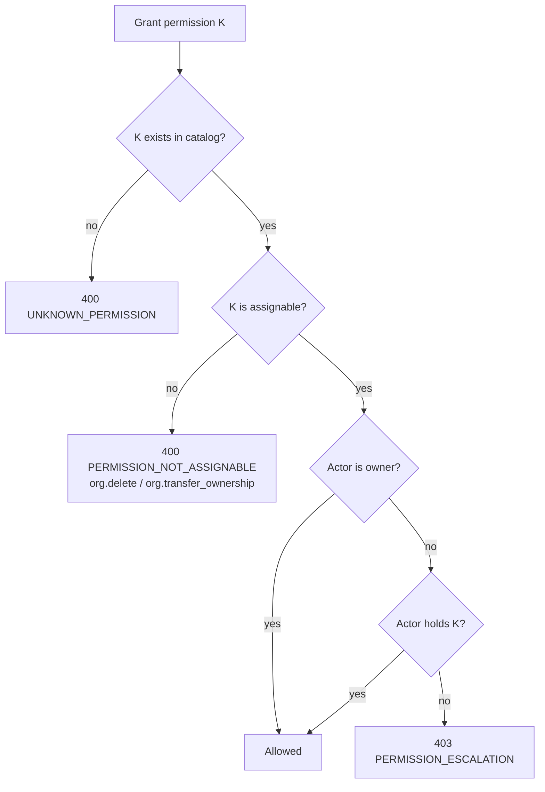

This is the anti-escalation rule. Without it, someone with `role.manage` could:

1. add `org.transfer_ownership` to a role,
2. assign that role to themselves,
3. take over the workspace.

## 5.4 Can I assign a role to someone?

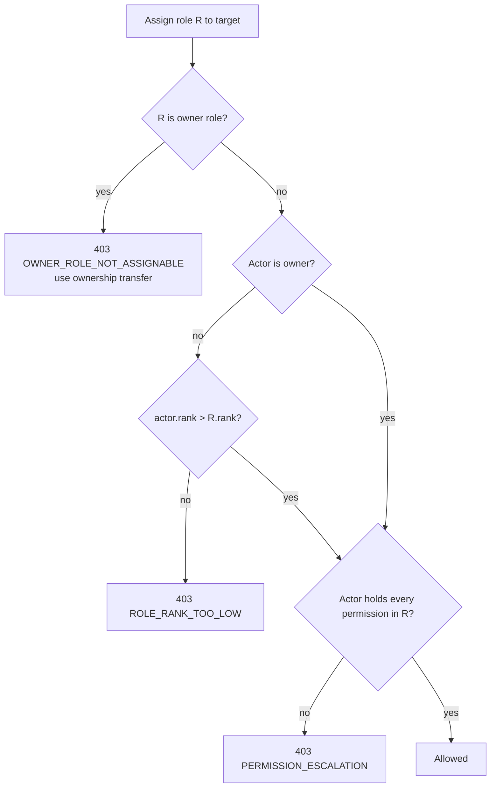

The subset check matters because rank alone is not enough: a low-ranked
"Auditor" role could secretly contain `org.delete`.

## 5.5 Can I manage this member?

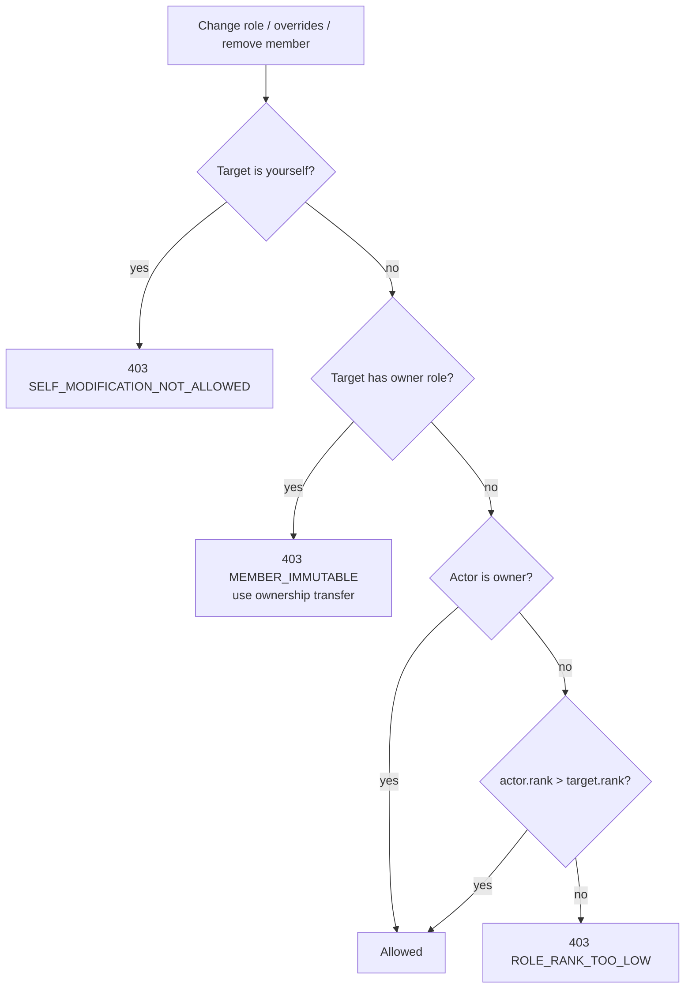

## 5.6 Last-owner protection

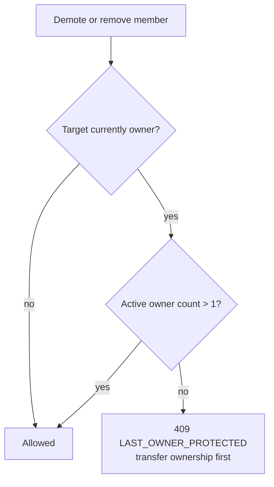

---

# Part 6 — Create organization flow

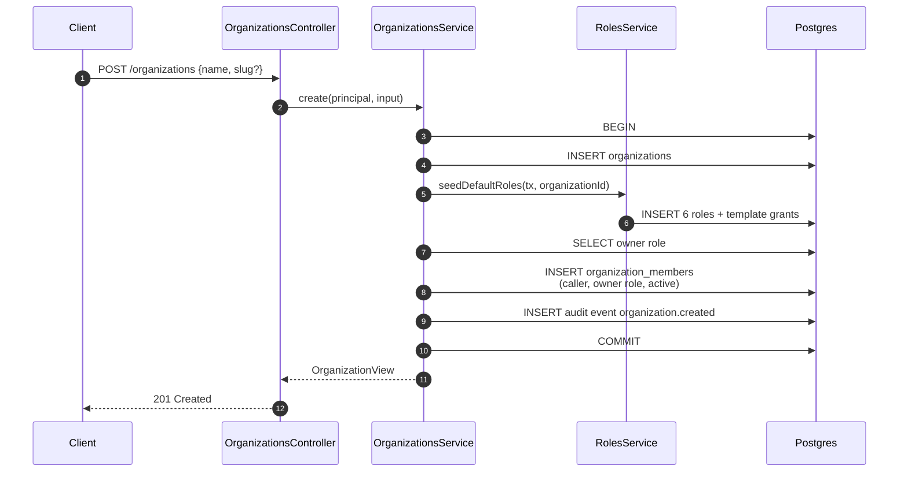

Why it is one transaction: an organization must never exist without an owner
role or without its founder as a member.

---

# Part 7 — Member and role management flows

## 7.1 Change a member's role

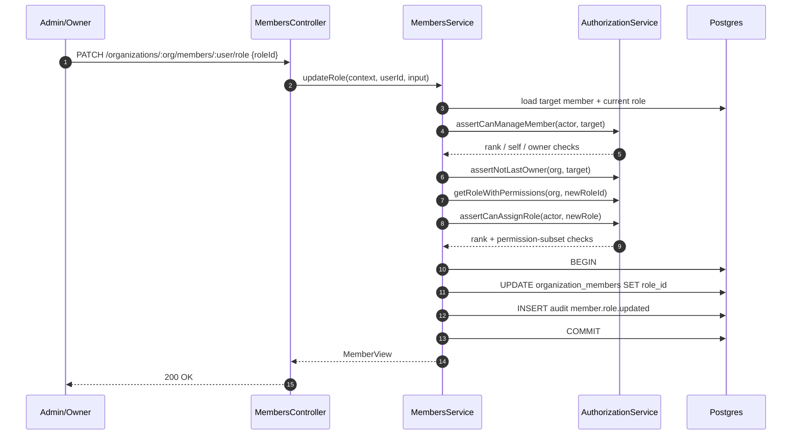

## 7.2 Replace a member's overrides

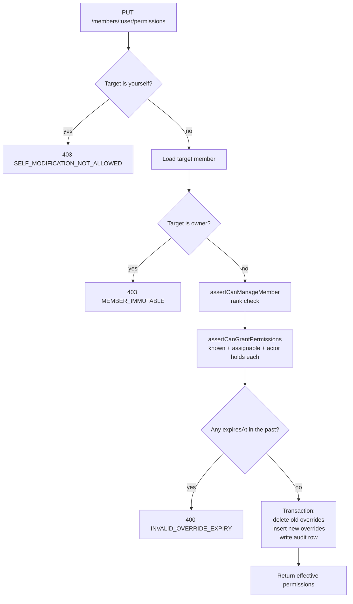

Overrides are **replaced wholesale**. Sending `"overrides": []` removes every
override for that member.

## 7.3 Create or edit a role

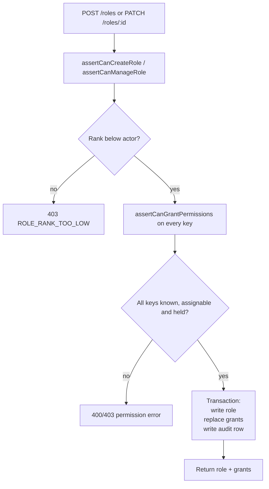

Role deletion has extra guards:

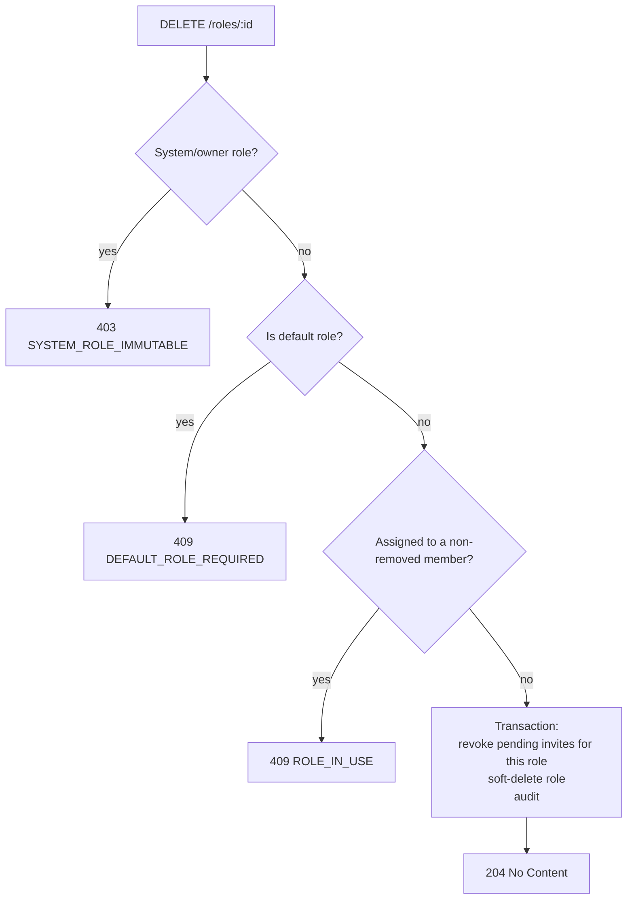

---

# Part 8 — Invitation flows

## 8.1 Create and send an invitation

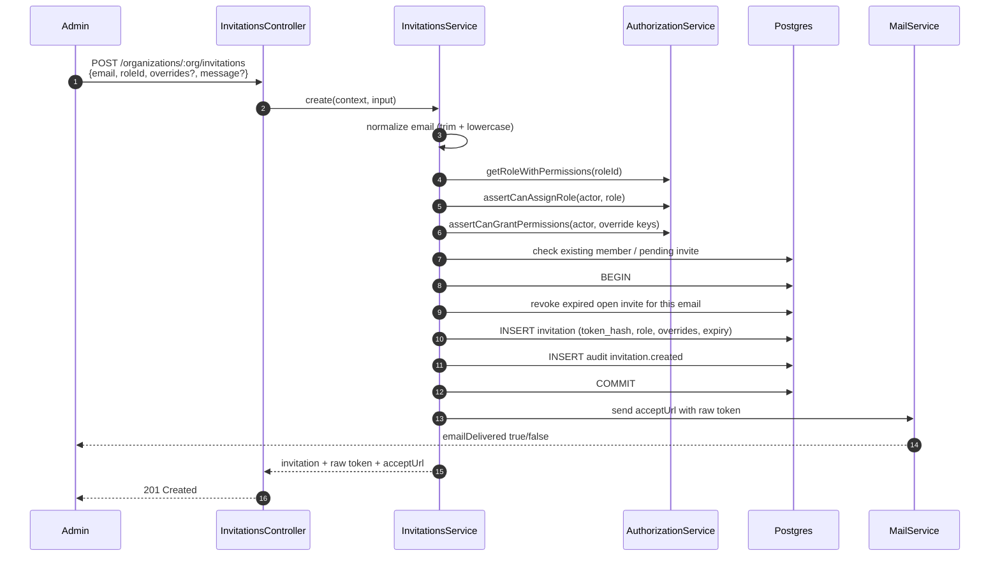

The raw token appears exactly once in the response/email. The database only has
its SHA-256 hash.

## 8.2 Preview and accept

```mermaid
sequenceDiagram
    autonumber
    participant Invitee
    participant Public as PublicInvitationsController
    participant Ctrl as PublicInvitationsController
    participant S as InvitationsService
    participant DB as Postgres

    Invitee->>Public: GET /invitations/:token (public)
    Public->>S: preview(token)
    S->>DB: find by token_hash, not accepted/revoked, not expired
    alt invalid/expired/revoked/accepted
        S-->>Invitee: 404 INVITE_NOT_FOUND (generic)
    else valid
        S-->>Invitee: org name, email, role, inviter, message
    end

    Invitee->>Ctrl: POST /invitations/:token/accept (authenticated)
    Ctrl->>S: accept(principal, token)
    S->>DB: BEGIN + SELECT ... FOR UPDATE
    S->>S: verify token, expiry, email match
    S->>DB: verify role still exists
    S->>DB: create or reactivate organization_members
    S->>DB: copy non-expired invite overrides
    S->>DB: mark invitation accepted
    S->>DB: INSERT audit invitation.accepted
    S->>DB: COMMIT
    S-->>Invitee: organization + role + effective permissions
```

Generic 404 is deliberate: it prevents probing for valid invite tokens or
learning whether an email has a pending invitation.

## 8.3 Resend and revoke

```mermaid
flowchart LR
    A["POST /invitations/:id/resend"] --> B{"Accepted?"}
    B -- yes --> B1["409 INVITE_ALREADY_ACCEPTED"]
    B -- no --> C{"Revoked?"}
    C -- yes --> C1["409 INVITE_REVOKED"]
    C -- no --> D["Rotate token<br/>extend expiry<br/>send email<br/>audit"]
    D --> E["Old token now 404"]

    F["DELETE /invitations/:id"] --> G{"Accepted?"}
    G -- yes --> G1["409 INVITE_ALREADY_ACCEPTED"]
    G -- no --> H["Set revoked_at<br/>audit"]
    H --> I["Token now 404"]
```

---

# Part 9 — Ownership transfer

```mermaid
sequenceDiagram
    autonumber
    participant Owner
    participant Ctrl as OrganizationsController
    participant S as OrganizationsService
    participant DB as Postgres

    Owner->>Ctrl: POST /organizations/:org/transfer-ownership {userId}
    Ctrl->>S: transferOwnership(context, userId)
    S->>S: assertOwner(context)
    S->>DB: load target member + role
    alt target missing / inactive
        S-->>Owner: 404 MEMBER_NOT_FOUND
    else target already owner
        S-->>Owner: 409 ALREADY_OWNER
    else valid
        S->>DB: BEGIN
        S->>DB: target.role = owner role
        S->>DB: actor.role = target's previous role
        S->>DB: INSERT audit ownership.transferred
        S->>DB: COMMIT
        S-->>Owner: 204 No Content
    end
```

The swap keeps exactly one owner and leaves the outgoing owner with a meaningful
role instead of null.

---

# Part 10 — Audit trail

Every security-sensitive mutation writes `organization_audit_events` in the same
transaction as the change:

| Action | Trigger |
| --- | --- |
| `organization.created` | New organization |
| `organization.updated` | Org name/slug/logo/settings changed |
| `organization.ownership.transferred` | Ownership hand-off |
| `role.created` | Custom role created |
| `role.updated` | Role name/description/rank/default changed |
| `role.permissions.replaced` | Role grant set replaced |
| `role.deleted` | Role soft-deleted |
| `member.role.updated` | Member moved between roles |
| `member.removed` | Member marked removed |
| `member.overrides.replaced` | Personal overrides replaced |
| `invitation.created` | Invite created |
| `invitation.resent` | Token rotated and expiry extended |
| `invitation.revoked` | Invite revoked |
| `invitation.accepted` | Invite accepted |

```mermaid
flowchart LR
    A["Service transaction"] --> B["Business write"]
    A --> C["AuditService.record(tx, event)"]
    B --> D{"COMMIT"}
    C --> D
    D -- success --> E["Both rows visible"]
    D -- failure --> F["Both rows rolled back"]
```

An audit trail with holes is not an audit trail, which is why `record()` takes the
same transaction object instead of firing and forgetting.

---

# Part 11 — Reading order for this codebase

If you are new to NestJS, read in this order:

1. `packages/auth/src/permissions.ts` — the vocabulary and six templates.
2. `packages/db/src/schema/organization.schema.ts` — the tables and keys.
3. `apps/api/src/auth/auth.types.ts` and `identity.guard.ts` — who is calling.
4. `apps/api/src/authorization/organization-access.guard.ts` — the bouncer.
5. `apps/api/src/authorization/authorization.service.ts` — the central rules.
6. `apps/api/src/organizations/organizations.service.ts` — create/transfer.
7. `apps/api/src/roles/roles.service.ts` — role CRUD and seeding.
8. `apps/api/src/members/members.service.ts` — member role/overrides.
9. `apps/api/src/invitations/invitations.service.ts` — invite lifecycle.
10. `apps/api/src/common/` — errors, cursors, decorators, validation.

Then pick one endpoint and trace it:

```text
roles.controller.ts -> roles.service.ts -> authorization.service.ts
                    -> audit.service.ts  -> organization.schema.ts
```

---

# Part 12 — Quick local walkthrough

The dev identity provider trusts `x-user-id`. You need an active `users` row:

```bash
# 1. Create a user directly (there is no signup endpoint yet)
docker exec -i heddlio-postgres psql -U postgres -d heddlio -c "
  INSERT INTO users (id, email, name, password, status)
  VALUES (gen_random_uuid(), 'you@example.com', 'You', 'dev', 'active')
  RETURNING id;
"

# 2. Call the API with that id
curl http://localhost:8080/organizations \
  -H "x-user-id: <id-from-step-1>"

# 3. Create an organization; you become the owner
curl -X POST http://localhost:8080/organizations \
  -H "content-type: application/json" \
  -H "x-user-id: <id-from-step-1>" \
  -d '{"name":"My Workspace"}'

# 4. See the six seeded roles
curl http://localhost:8080/organizations/<org-id>/roles \
  -H "x-user-id: <id-from-step-1>"

# 5. See your effective permissions
curl http://localhost:8080/organizations/<org-id>/members/<id-from-step-1>/permissions \
  -H "x-user-id: <id-from-step-1>"
```

Without a valid `x-user-id`, every non-public route returns `401`. With a valid
user who is not a member of the organization, org routes return `403
NOT_A_MEMBER`.

---

# Part 13 — Error cheat sheet

| HTTP | Code | Meaning |
| --- | --- | --- |
| 401 | `UNAUTHENTICATED` | No valid identity |
| 403 | `NOT_A_MEMBER` | Authenticated but not in this organization |
| 403 | `MEMBERSHIP_INACTIVE` | Membership is invited/suspended/removed |
| 403 | `MISSING_PERMISSION` | Member lacks a required permission |
| 403 | `OWNER_ONLY` | Operation reserved for the owner |
| 403 | `ROLE_RANK_TOO_LOW` | Target role rank is not strictly below yours |
| 403 | `PERMISSION_ESCALATION` | You tried to grant something you do not hold |
| 403 | `PERMISSION_NOT_ASSIGNABLE` | Tried to grant owner-only permission |
| 403 | `SYSTEM_ROLE_IMMUTABLE` | Tried to edit/delete the owner role |
| 403 | `OWNER_ROLE_IMMUTABLE` | Tried to manage the owner role |
| 403 | `OWNER_ROLE_NOT_ASSIGNABLE` | Tried to assign owner via role change/invite |
| 403 | `SELF_MODIFICATION_NOT_ALLOWED` | Tried to change your own role/overrides |
| 403 | `MEMBER_IMMUTABLE` | Tried to manage the owner member |
| 409 | `LAST_OWNER_PROTECTED` | Would leave the org without an owner |
| 409 | `DEFAULT_ROLE_REQUIRED` | Would leave the org without a default role |
| 409 | `ROLE_IN_USE` | Reassign members before deleting this role |
| 404 | `INVITE_NOT_FOUND` | Invalid, expired, revoked or accepted invite |
| 403 | `INVITE_EMAIL_MISMATCH` | Signed-in email does not match the invite |
| 409 | `INVITE_ALREADY_ACCEPTED` | Cannot resend/revoke an accepted invite |
| 409 | `INVITE_REVOKED` | Cannot resend a revoked invite |
| 409 | `ALREADY_MEMBER` | Email already belongs to an active member |
| 409 | `INVITE_ALREADY_PENDING` | A live invite already exists for that email |
| 400 | `VALIDATION_ERROR` | Zod rejected the body/query/param |
